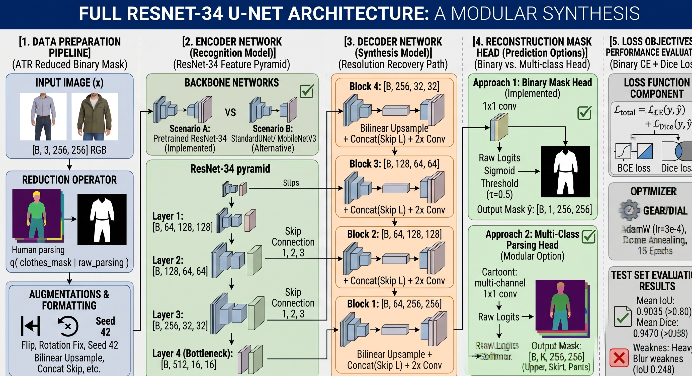

# Hands-on Clothes Segmentation (U-Net, BCE + Dice)

A clothes segmentation system that separates worn clothes from people in photos, built for assignment `CVCY002`.

- **Dataset**: ATR human parsing (17,706 images, 18 classes), converted to a binary *clothes vs. everything else* mask.
- **Model**: U-Net with an ImageNet-pretrained ResNet-34 encoder and a hand-written decoder with skip connections (no attention), 24.4 M parameters. A plain from-scratch U-Net (`standard_unet`) is also registered.
- **Loss**: Binary cross-entropy + soft Dice (1 : 1).
- **Metrics**: IoU, Dice, pixel accuracy, precision, recall (per image and corpus-level).
- **Personal-image pipeline**: `seg predict --image photo.jpg` writes a mask, an overlay, a transparent clothes cut-out and a diagnostic panel.

## Results (test split, 1,772 images)

| IoU | Dice | Pixel acc. | Precision | Recall | Target |
|---|---|---|---|---|---|
| **0.904** | **0.947** | 0.986 | 0.943 | 0.955 | IoU ≥ 0.80, Dice ≥ 0.88 ✅ |

Trained for 15 epochs (87 min) on a 4 GB Quadro T2000.

The full write-up (dataset choice, architecture, loss, results, strengths, failure modes and limitations) is in [`docs/reports/clothes-segmentation-report.md`](docs/reports/clothes-segmentation-report.md).

## 1. Setup

Tested on Python 3.12, PyTorch 2.6.0 (CUDA 12.4) and an NVIDIA Quadro T2000 (4 GB). A CPU works too but training is slow.

```bash
python3 -m venv clothes-unet
source clothes-unet/bin/activate
pip install torch==2.6.0 torchvision==0.21.0 --index-url https://download.pytorch.org/whl/cu124
pip install -e ".[dev]"
seg --version
```

## 2. Data

```bash
seg prepare-data -c configs/atr_unet.yaml
```

This command:
1. downloads the ATR parquet shards (~760 MB) from the public Hugging Face mirror `mattmdjaga/human_parsing_dataset` into `data/raw/` (no account or token needed);
2. writes `data/processed/images/*.jpg` and binary masks `data/processed/masks/*.png` (≈1 min);
3. writes a seeded 80/10/10 split to `data/splits/{train,val,test}.txt` (14,164 / 1,770 / 1,772).

**Clothes label rule** (`data.clothes_ids` in the config): `4 upper-clothes, 5 skirt, 6 pants, 7 dress, 8 belt, 17 scarf` → 1. Everything else is 0, including accessories (hat, sunglasses, bag), shoes, hair, skin and background.

## 3. Verify (pre-training gate)

```bash
seg verify -c configs/atr_unet.yaml
```

Checks config validity, batch shapes, a finite loss, gradient flow, one optimizer step and the 3 GB GPU memory budget (measured: ~2.6 GB at batch 16, 256×256, fp32).

## 4. Train

```bash
seg train -c configs/atr_unet.yaml                       # 15 epochs, ~6 min/epoch on a T2000
seg train -c configs/atr_unet.yaml --epochs 5 --batch-size 8 --output-dir artifacts/runs/quick
seg train -c configs/atr_unet.yaml --resume artifacts/runs/atr_resnet34_unet/latest.pt
```

The run directory (`artifacts/runs/atr_resnet34_unet/`) contains `latest.pt`, `best_checkpoint.pt` (highest validation IoU), `final_checkpoint.pt`, periodic `checkpoint_epoch_NNN.pt`, `metrics.json`, `learning_curves.png`, `train.log` and `resolved_config.yaml`.

**Pretrained weights**: the reported run's logs, metrics, galleries and predictions are committed under `artifacts/`. The checkpoints (280 MB each) exceed GitHub's file limit, so `best_checkpoint.pt` is published as a release asset. Download it to skip training:

```bash
gh release download v1.0.0 -R Abd-Elfattah5/Hands-on-Segmentation -p best_checkpoint.pt -D artifacts/runs/atr_resnet34_unet
```

Or download it from the [v1.0.0 release page](https://github.com/Abd-Elfattah5/Hands-on-Segmentation/releases/tag/v1.0.0).

## 5. Evaluate

```bash
seg evaluate -k artifacts/runs/atr_resnet34_unet/best_checkpoint.pt --split test
```

Writes `eval_test/eval_metrics.json` (overall metrics, breakdown by garment area, best/worst sample IDs) and `best_cases_gallery.png` / `worst_cases_gallery.png`. It prints whether the target (**test IoU ≥ 0.80 and Dice ≥ 0.88**) is met.

```bash
seg robustness -k artifacts/runs/atr_resnet34_unet/best_checkpoint.pt
```

Re-evaluates the test set under simulated capture conditions (dim/overexposed lighting, low contrast, grayscale, blur, low resolution, noise, 30° rotation, close-up crop) and writes `robustness_test/robustness_metrics.json`.

## 6. Segment your own photo

```bash
seg predict -k artifacts/runs/atr_resnet34_unet/best_checkpoint.pt --image samples/personal/me.jpg
```

Outputs in `artifacts/predictions/`:

| File | Content |
|---|---|
| `me_mask.png` | Binary clothes mask at the original resolution |
| `me_overlay.png` | Mask blended over the photo |
| `me_clothes.png` | RGBA cut-out: clothes kept, everything else transparent |
| `me_panel.png` | Side-by-side input / overlay / cut-out |

JPEG, PNG and **HEIC/HEIF** (iPhone and many Android cameras) are accepted directly. The phone's EXIF rotation is applied automatically, so portrait photos are not fed to the model sideways.

Best results come from a single, upright, mostly full-body person, in reasonable lighting (see the report's limitations section).

## 7. Tests

```bash
pytest tests/unit -v
```

Covers model shapes, loss values, metrics on known masks, paired transforms, checkpoint round-trip and the predict pipeline.

## 8. Repository Layout

```text
configs/atr_unet.yaml        data paths, label mapping, model, loss weights, training
src/cli/main.py              Typer CLI `seg`: verify, prepare-data, train, evaluate, robustness, predict
src/configs/schema.py        dataclass schema + validation
src/data/                    download, binary-mask preprocessing + splits, paired augmentation
src/models/                  registry, ResNet-34 U-Net, plain U-Net
src/training/                BCE + Dice loss, atomic checkpoints, trainer (resume, best/latest/final)
src/evaluation/              metrics, test-split evaluator, overlays and galleries
src/inference/predict.py     personal-image pipeline
tests/unit/                  pytest suite
docs/reports/                assignment report + figures
docs/adr/                    architecture decision records
ARCHITECTURE_DEEP_DIVE.md    design rationale for every decision
Architecture_visualization.jpg  one-page visual summary of the architecture
architectural_enhancements_taxonomy.html  swappable components and possible enhancements
CONTEXT.md                   domain glossary
HANDOFF.md                   implementation handoff and requirements checklist
```



## License

This project is licensed under the MIT License.
