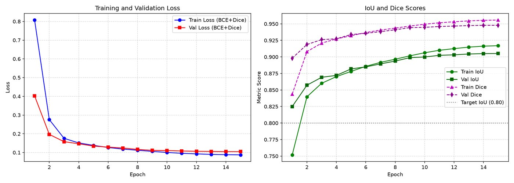
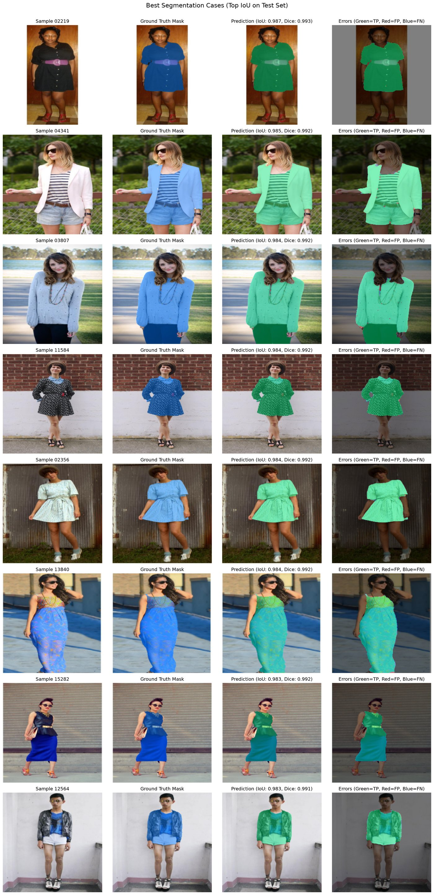
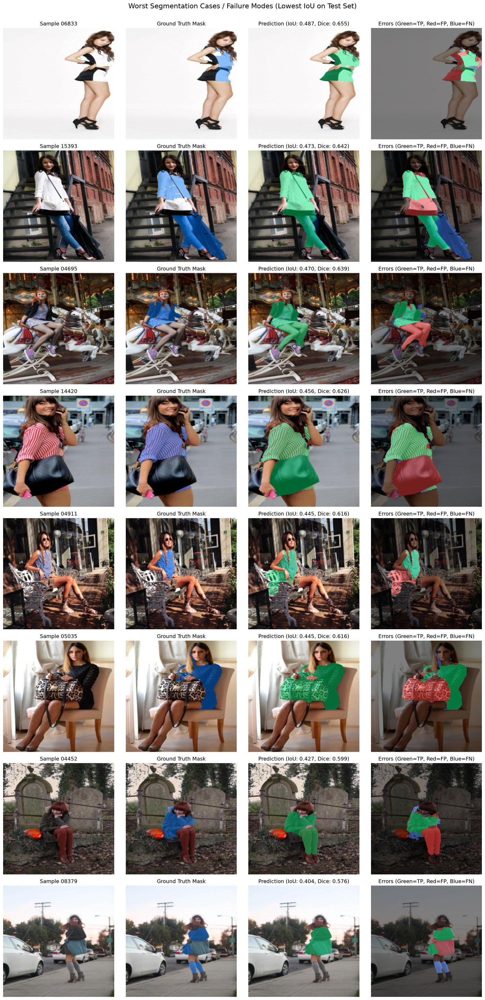
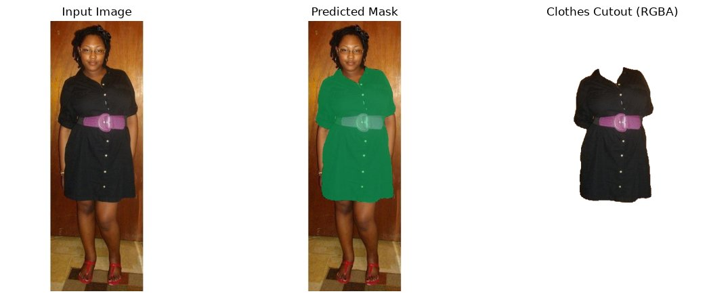
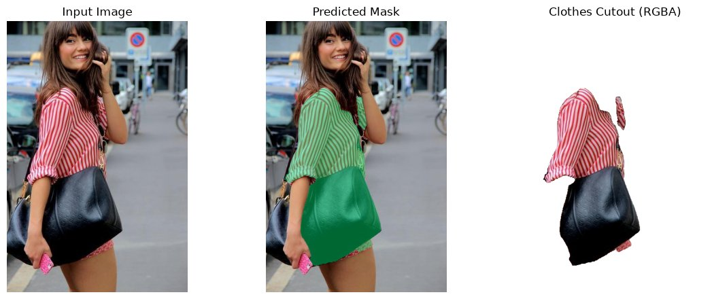
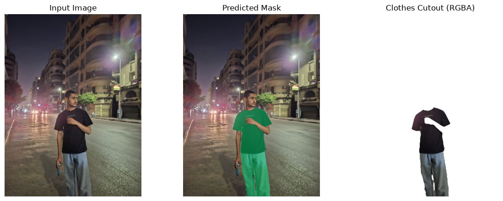
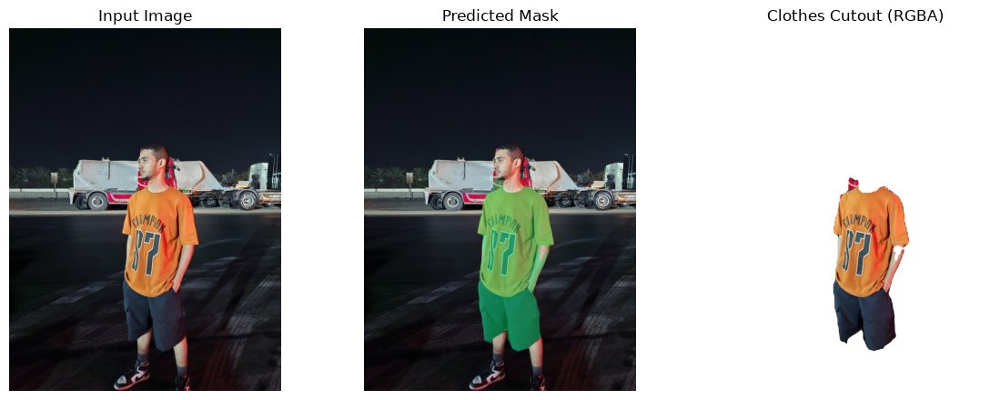
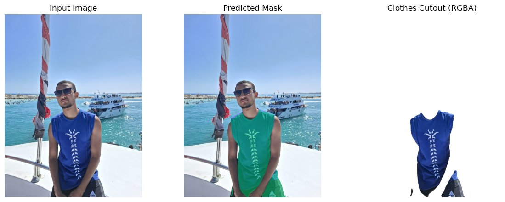
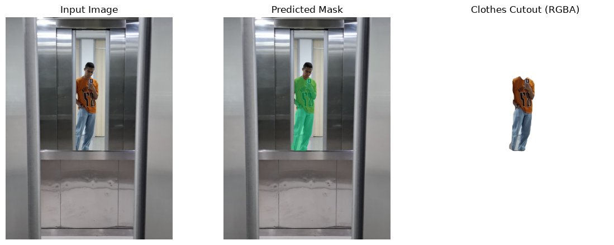
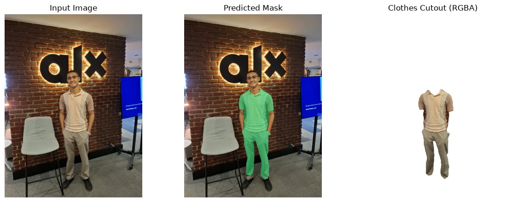

# Clothes Segmentation Report (Assignment CVCY002)

**Result in one line**: a U-Net with a pretrained ResNet-34 encoder, trained with BCE + Dice on the ATR human-parsing dataset, reaches **test IoU 0.904 and Dice 0.947** on 1,772 held-out images, above the target of IoU ≥ 0.80 and Dice ≥ 0.88.

All numbers below come from `artifacts/runs/atr_resnet34_unet/` and are copied into `docs/reports/figures/` (`eval_metrics.json`, `robustness_metrics.json`).

---

## 1. Task Definition

The assignment asks to "segment the clothes from people" for use cases such as virtual fitting rooms. I model this as **binary semantic segmentation**: every pixel is either *worn clothing* (1) or *anything else* (0): skin, hair, accessories, background. Binary output fits the stated goal directly (a clothes mask and a clothes cut-out) and keeps the loss and metrics simple. Per-garment classes would be a straightforward extension, since the dataset has them.

## 2. Dataset

### 2.1 Choice: ATR human parsing

| Candidate | Size | Why / why not |
|---|---|---|
| **ATR** (chosen) | 17,706 images, 18 pixel-level classes | Real photos of full people in varied poses, backgrounds and lighting; garment-level labels; public mirror with no login (`mattmdjaga/human_parsing_dataset` on Hugging Face) |
| Clothing Co-Parsing | ~1,000 images | Too small; fashion-catalogue style, so weaker generalisation to personal photos |
| DeepFashion2 / ModaNet / iMaterialist | large | Access forms, scraping, or 20+ GB downloads; too slow for a one-day project |

ATR is a standard human-parsing benchmark. Its photos show whole people in street and indoor scenes, which is close to the target input: a personal photo of a person wearing clothes.

### 2.2 Binary label mapping

ATR classes: 0 background, 1 hat, 2 hair, 3 sunglasses, 4 upper-clothes, 5 skirt, 6 pants, 7 dress, 8 belt, 9/10 shoes, 11 face, 12/13 legs, 14/15 arms, 16 bag, 17 scarf.

- **Clothes = 1**: upper-clothes, skirt, pants, dress, belt, scarf (`data.clothes_ids: [4, 5, 6, 7, 8, 17]` in `configs/atr_unet.yaml`).
- **Excluded**: hat, sunglasses and bag are accessories. A bag is carried, not worn, and would be wrong in a try-on cut-out. Shoes are footwear, which virtual try-on usually treats separately. Hair, skin and background are not clothes.

The list lives in the config, so the mapping can be changed and the data regenerated with one command.

### 2.3 Preprocessing and split

`seg prepare-data` (`src/data/dataset.py`):
1. reads the two parquet shards and saves each image as JPEG and its binary mask as PNG (0/255);
2. shuffles with seed 42 and writes an **80 / 10 / 10** split to `data/splits/*.txt`: **14,164 train / 1,770 val / 1,772 test**. ATR has no official split, so the saved ID lists make the split reproducible.

Images are resized to **256×256** for training. Images are bilinear-resized and masks nearest-neighbour-resized, so masks stay binary. Inputs are normalised with ImageNet statistics to match the pretrained encoder.

### 2.4 Augmentation (training only)

`src/data/transforms.py`, `PairedSegmentationTransform`. Geometric operations use identical random parameters for the image and the mask:

| Augmentation | Range | Purpose |
|---|---|---|
| Horizontal flip | p = 0.5 | Left/right symmetry of people |
| Rotation | ±10° | Slightly tilted cameras |
| Scale | 0.9 to 1.1 | Varying distance to camera |
| Translation | ±5 % | Off-centre framing |
| Brightness / contrast / saturation (image only) | ×0.8 to 1.2 | Lighting and white balance variation |

Validation and test images only get resize and normalisation.

## 3. Model Architecture

`src/models/unet.py`, `ResNet34UNet` (24.4 M parameters), a standard U-Net encoder-decoder with skip connections and **no attention**:

```text
input 3×256×256
 ├ encoder (torchvision ResNet-34, ImageNet weights)
 │   conv1+bn+relu  → 64×128×128  ─────────────┐ skip
 │   maxpool+layer1 → 64×64×64    ───────────┐ │
 │   layer2         → 128×32×32   ─────────┐ │ │
 │   layer3         → 256×16×16   ───────┐ │ │ │
 │   layer4         → 512×8×8 (bottleneck)│ │ │ │
 └ decoder (hand-written)                 │ │ │ │
     up×2 + concat + 2×(conv3×3-BN-ReLU) → 256×16×16
     up×2 + concat + 2×(conv-BN-ReLU)    → 128×32×32
     up×2 + concat + 2×(conv-BN-ReLU)    → 64×64×64
     up×2 + concat + 2×(conv-BN-ReLU)    → 32×128×128
     up×2 + 2×(conv-BN-ReLU)             → 16×256×256
     conv1×1                             → 1×256×256 logits
```

**Why this design**
- **U-Net**: skip connections carry high-resolution detail to the decoder, which is what garment boundaries need. It is the standard, well-understood architecture for dense binary segmentation.
- **Pretrained ResNet-34 encoder**: ImageNet features already separate textures, fabrics and skin. Validation IoU was 0.825 after a single epoch, so pretraining made the unstated "minimum performance" bar low-risk on a one-day schedule.
- **No attention**: garments are large, contiguous regions, so local convolutional context is enough. Attention would cost memory on a 4 GB GPU.
- **Bilinear upsampling + convolution** instead of transposed convolutions avoids checkerboard artefacts.

A plain U-Net trained from scratch (`standard_unet`, 7.8 M parameters) is also implemented and registered for comparison. Time did not allow a full training run of it.

## 4. Loss Function: BCE + Dice

`src/training/losses.py`:  `L = 1.0 · BCE(logits, y) + 1.0 · (1 − SoftDice(σ(logits), y))`

| Term | What it does | Why it is needed here |
|---|---|---|
| **Binary cross-entropy** | Per-pixel log loss; smooth, well-conditioned gradients | Stable optimisation from the first step; calibrated probabilities, so the 0.5 threshold is meaningful |
| **Soft Dice** | Directly optimises region overlap, computed per image | **Class imbalance**: clothes cover only ~14 % of pixels on average (64 % of test images are < 15 % clothes). With BCE alone, background pixels dominate and the model under-segments. Dice weighs foreground overlap independently of background size, and it matches the IoU/Dice evaluation metric |

The combination is the common choice for binary segmentation. BCE gives stable pixel-level gradients and Dice keeps the model focused on the foreground region. Equal weights worked well, so I did no further tuning.

## 5. Training Setup

| Setting | Value |
|---|---|
| Optimiser | AdamW, lr 3e-4, weight decay 1e-4 |
| Schedule | 500-step linear warm-up, then cosine decay to 1e-6 |
| Batch / resolution | 16 × 256×256, fp32 (mixed precision not needed) |
| Epochs | 15 (885 steps each), gradient clipping at 1.0 |
| Model selection | Checkpoint with the best **validation IoU** |
| Hardware | NVIDIA Quadro T2000 4 GB; measured peak **2,640 MiB** (`seg verify`, within a 3 GB budget) |
| Time | 86.7 min total (~5.8 min per epoch) |
| Seed | 42 (Python, NumPy, PyTorch, cuDNN deterministic) |



Validation IoU rises steadily (0.825 → 0.857 → 0.869 → … → 0.905) and plateaus over the last three epochs as the cosine schedule ends. The gap between train IoU (0.917) and validation IoU (0.905) is small, and validation loss never goes up, so the model is **not overfitting**. More epochs would add very little.

## 6. Performance Analysis

### 6.1 Target ("minimum required performance")

The assignment states no number. I set **test IoU ≥ 0.80 and Dice ≥ 0.88** for the binary clothes mask before training. Reasons:
- 0.80 IoU means that, of the union of predicted and true clothes pixels, at least 80 % are correct. Visually, that is a mask that follows the garment outline with errors limited to edges.
- Published human-parsing models reach high 0.8x to 0.9x IoU on large garment classes, so this bar is realistic for a binary mask.

### 6.2 Test results (1,772 images, threshold 0.5)

| Metric | Value | Target |
|---|---|---|
| **IoU** (mean per image) | **0.9035** | ≥ 0.80 ✅ |
| **Dice / F1** (mean per image) | **0.9470** | ≥ 0.88 ✅ |
| Pixel accuracy | 0.9859 | — |
| Precision | 0.9430 | — |
| Recall | 0.9552 | — |
| IoU (corpus-level, all pixels pooled) | 0.9040 | — |
| Dice (corpus-level) | 0.9496 | — |

Validation (0.9052 IoU) and test (0.9035 IoU) agree closely, so the selected checkpoint generalises within the dataset distribution. Recall is slightly higher than precision: the model tends to **over-segment** a little rather than miss clothing (Section 7.2 explains why).

Pixel accuracy (98.6 %) is inflated by the large background area. **IoU and Dice are the meaningful metrics** here.

### 6.3 Breakdown by clothes area

| Clothes area in image | Images | Mean IoU | Median IoU |
|---|---|---|---|
| Small (< 15 % of pixels) | 1,141 | 0.896 | 0.926 |
| Medium (15–40 %) | 624 | 0.917 | 0.940 |
| Large (> 40 %) | 7 | 0.878 | 0.892 |

Small garment regions score lower because each boundary or accessory error is a larger fraction of a small mask. All eight worst test images are in the "small" group. The "large" group has only 7 images and is not statistically meaningful.

## 7. Discover System Capabilities

### 7.1 Strengths (task 3a)



*Columns: input, ground truth, prediction, errors (green = correct, red = false positive, blue = missed).*

- **High overall accuracy**: median test IoU is about 0.93. The best images reach IoU 0.98+, with errors only on a one-to-two-pixel boundary.
- **Separates clothes from skin and hair reliably**: bare arms and legs, necklines and faces are excluded cleanly, even when skin and fabric have similar colours (sample 02219).
- **Robust to garment appearance**: works on solid colours, stripes (04341), florals and prints (13840, 11584), sheen and leather jackets (12564), and layered outfits such as a blazer over a striped top (04341).
- **Handles busy backgrounds**: brick walls, foliage, corrugated metal, streets.
- **Robust to moderate capture variation** (Section 7.3): dim lighting (−0.01 IoU), low contrast (−0.01), 30° camera tilt (−0.04) and close-up upper-body framing (−0.06) all keep IoU above 0.84.
- **Fast and light**: about 0.15–0.2 s per photo end-to-end on the T2000, including upsampling the mask to the original resolution. It runs on a 4 GB laptop GPU or a CPU.

### 7.2 Drawbacks and wrong segmentation (task 3b)



The eight lowest-IoU test images (IoU 0.40–0.49; one test image was left out of the gallery only, but still counts in all metrics) show these recurring failure modes:

1. **Bags segmented as clothes** (14420, 05035, 15393): large handbags held against the body share fabric and leather texture with garments. The model labels them as clothing, while the label rule excludes bags. This is the most frequent false positive.
2. **Tights, stockings and leggings** (04695, 04452, 08379): ATR is inconsistent here. Opaque tights are sometimes labelled *legs*, sometimes *pants*, so ground truth itself is ambiguous. The model predicts them as clothes (red), which is arguably correct for try-on, but it scores as an error.
3. **Clothes-like objects touching the person** (04911 cushion and bag on a bench): fabric the person is sitting on is partly segmented. The model has learned "fabric near a person", not strictly "fabric worn by a person".
4. **Not-worn garments** (15393): a coat hanging from a stair rail is labelled clothes in ground truth but missed by the model (blue). A coat that is held rather than worn is genuinely ambiguous.
5. **Incomplete ground truth** (06833): only the white half of a black-and-white outfit is annotated. The model segments the whole outfit correctly, but the black half scores as false positive. Here the model is right and the label is wrong.

Other observed weaknesses:
- **Boundary softness**: masks are predicted at 256×256 and upsampled, so on high-resolution photos edges are slightly blurred and thin structures (straps, belts, drawstrings) can be lost.
- **Unusual poses** (sitting, crossed legs, 04911 and 04452) produce lower IoU than standing poses, which dominate ATR.
- **Some worst-case "errors" are annotation noise** (cases 2, 4 and 5), so the true failure rate is somewhat lower than the raw numbers suggest.

### 7.3 Limitations and capture conditions (task 3c)

To make the capture limits measurable, `seg robustness` re-runs the full test set under simulated capture conditions (`src/evaluation/robustness.py`):

| Capture condition | Test IoU | Dice | ΔIoU vs clean | Verdict |
|---|---|---|---|---|
| Clean (reference) | 0.904 | 0.947 | — | |
| Dim lighting (brightness ×0.4) | 0.894 | 0.941 | −0.010 | ✅ robust |
| Haze / flat light (contrast ×0.4) | 0.891 | 0.940 | −0.012 | ✅ robust |
| Tilted camera (30° rotation) | 0.859 | 0.919 | −0.044 | ✅ acceptable |
| Close-up upper-body framing (top half, 2× zoom) | 0.846 | 0.906 | −0.058 | ✅ acceptable |
| Overexposed (brightness ×1.8) | 0.837 | 0.905 | −0.067 | ⚠️ degraded, still above target |
| Grayscale / no colour | 0.798 | 0.880 | −0.106 | ⚠️ at target boundary |
| Sensor noise (σ = 0.08) | 0.689 | 0.788 | −0.215 | ❌ below target |
| Low resolution (¼ resolution, upsampled) | 0.597 | 0.677 | −0.307 | ❌ below target |
| Out of focus / motion blur (Gaussian σ = 3) | 0.248 | 0.308 | −0.656 | ❌ fails |

The model relies heavily on **fine texture and edges**. Blur, low resolution and noise destroy exactly those cues, and none of them appear in the training augmentation. Lighting changes, by contrast, are well tolerated.

**Supported operating conditions** (stated limits of the system):

| Condition | Supported | Not supported / unreliable |
|---|---|---|
| Subject | **One person**, roughly centred, occupying most of the frame | Groups, crowds, very small people in the frame |
| Pose | Standing or walking, frontal or three-quarter view; upper-body or full-body | Lying down, heavily folded poses, back views (rare in ATR) |
| Image quality | Sharp, in focus, ≥ ~300 px on the short side, normal phone-camera noise | Motion blur, out-of-focus shots, heavy compression, low-light sensor noise, tiny thumbnails |
| Lighting | Indoor or outdoor, dim to bright, flat or hazy light | Strong overexposure or blown-out highlights; colourless (B/W) photos are borderline |
| Camera angle | Upright or tilted up to ~30° | Upside-down or extreme top-down angles |
| Occlusion | Light occlusion by arms or hair | Large bags held in front of the body (segmented as clothes), heavy occlusion by objects |
| Garments | Everyday Western casual and fashion clothing | Garments rare in ATR (e.g. traditional dress, costumes, uniforms, swimwear) are untested |
| Scope | Binary clothes mask | No garment type (shirt vs. pants), no instance separation between people, shoes and accessories excluded by design |

Further limitations:
- **Domain bias**: ATR is mostly young adult women in fashion and street photos. Trousers are well represented: pants appear in 56 % of images, versus 27 % for skirts and 26 % for dresses. The 5 personal photos of a man (Section 8) segment well, but children and non-Western clothing remain untested.
- **Photo orientation (EXIF)**: phone cameras store pixels sideways and record the rotation in an EXIF tag. The first version of the pipeline ignored that tag, so a portrait photo reached the model rotated 90°. That person-lying-sideways pose is absent from ATR, and **the jeans were missed completely**. The pipeline now applies `ImageOps.exif_transpose` and supports HEIC files; after the fix the same photo segments both T-shirt and jeans. This is a real deployment limitation: the model is **not rotation-invariant beyond ~30°** (Section 7.3).
- **No personal-photo ground truth**: personal photos have no annotations, so they are judged visually (Section 8). The simulated-condition table above is the quantitative stand-in.

## 8. Personal-Image Pipeline (task 2b)

`seg predict -k best_checkpoint.pt --image photo.jpg` (`src/inference/predict.py`):

1. load the photo in any size or format and convert it to RGB;
2. resize to 256×256 and normalise with ImageNet statistics;
3. run the U-Net and apply sigmoid → probability map;
4. **upsample the probability map bilinearly to the original resolution**, then threshold at 0.5. Upsampling probabilities rather than the binary mask gives smoother edges;
5. write `*_mask.png` (binary), `*_overlay.png` (tinted overlay), `*_clothes.png` (**RGBA cut-out with transparent background**, suitable for try-on compositing) and `*_panel.png` (side by side). It also prints clothes coverage and latency.




*Pipeline outputs on test photos at native 400×600 resolution. The second shows the handbag false positive described in Section 7.2.*

### 8.1 Personal photos

Five personal phone photos (3060×4080; four were HEIC, converted to upright JPEG) of a man, which is outside ATR's mostly-female distribution:

| # | Scene | Result |
|---|---|---|
| 1 | Night street, street-light glare, T-shirt + jeans | T-shirt and jeans segmented; the arm crossing the chest is correctly excluded |
| 2 | Night, orange jersey + shorts, harsh flash lighting | Jersey and shorts captured; a small piece of the head covering leaks into the mask; sneakers correctly excluded |
| 3 | Bright sunlight on a boat, sleeveless top, seated, cropped at the hips | Top and the visible shorts segmented; bare arms correctly excluded |
| 4 | Mirror selfie in a lift, person small in the frame (~25 % of image height) | Still segmented, but with coarser edges: few pixels per garment at 256×256 input |
| 5 | Indoor, backlit brick wall with logo, polo + chinos, full body | Clean full-outfit mask; chair and screen correctly ignored |







The photos confirm the operating conditions in Section 7.3. The model generalises to male subjects, trousers, shorts, night scenes and busy backgrounds. Quality drops when the person is small in the frame. Orientation must be corrected before inference.

## 9. Possible Improvements

| Weakness | Fix |
|---|---|
| Blur, noise and low-resolution fragility | Add Gaussian blur, noise, JPEG and down-sampling augmentation during training |
| Bags and other held objects | Train on all 18 classes (multi-class head) and merge garment classes at inference, so the model learns an explicit "bag" class |
| Soft boundaries on large photos | Train at 384×256 or 512×512, or add test-time flip augmentation |
| Tights ambiguity | Decide a consistent policy and relabel, or report it as a separate class |
| Domain bias | Fine-tune on a more diverse dataset (e.g. LIP, CIHP multi-person) |

## 10. Reproduction

```bash
seg prepare-data -c configs/atr_unet.yaml
seg verify       -c configs/atr_unet.yaml
seg train        -c configs/atr_unet.yaml
seg evaluate     -k artifacts/runs/atr_resnet34_unet/best_checkpoint.pt --split test
seg robustness   -k artifacts/runs/atr_resnet34_unet/best_checkpoint.pt
seg predict      -k artifacts/runs/atr_resnet34_unet/best_checkpoint.pt --image samples/personal/photo.jpg
```
